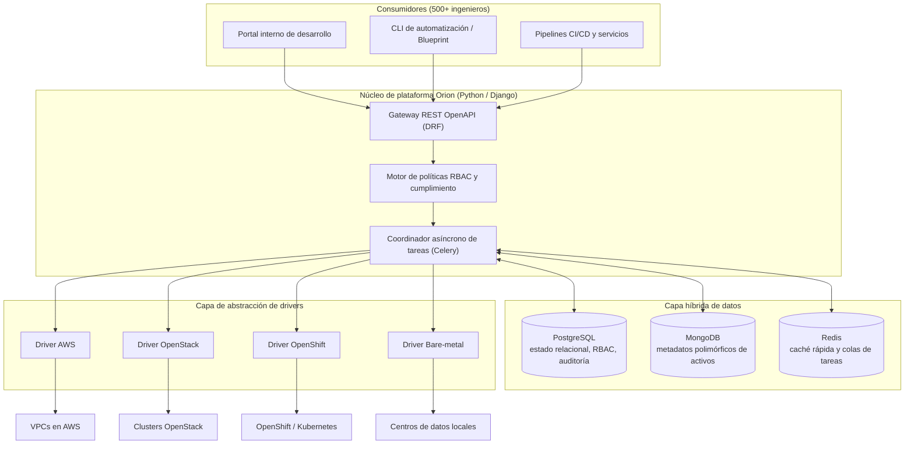

# Orion: Plataforma IaaS Corporativa para Aprovisionamiento y Auditoría

| Dimensión | Detalles |
| :--- | :--- |
| **Rol** | Arquitecto Único y Responsable de Plataforma |
| **Organización** | BBVA Technology (Infraestructura Core Banking) · 2017 – presente |
| **Escala** | Decenas de miles de nodos · Operaciones de alto rendimiento · 500+ ingenieros |
| **Stack** | Python, Django, DRF, Celery, PostgreSQL, MongoDB, Redis, AWS, OpenStack, OpenShift |

!!! abstract "Resumen ejecutivo (TL;DR)"

    Orion transforma cuatro mundos heterogéneos de infraestructura en **una única API en autoservicio
    y auditable en Python**. Una capa desacoplada de drivers aísla las particularidades de cada proveedor,
    Celery desacopla operaciones de larga duración del ciclo HTTP, y una capa híbrida de datos preserva
    la trazabilidad estricta en PostgreSQL mientras MongoDB absorbe metadatos variables de máquinas.

## 1. Contexto y desafío de ingeniería

A escala bancaria, distintos equipos aprovisionaban y auditaban infraestructura mediante canalizaciones
dispersas en entornos heterogéneos: **AWS**, nubes privadas (**OpenStack**), plataformas de contenedores
(**OpenShift**) y servidores físicos locales (**bare-metal**).

1. **Silos de entorno:** cada infraestructura requería su propio conjunto de herramientas, conocimientos y tickets manuales.
2. **Cuellos de botella en auditoría:** los reguladores bancarios exigen trazabilidad ininterrumpida del estado de las máquinas, líneas base de seguridad y titularidad en decenas de miles de nodos heterogéneos.
3. **Fricción para el desarrollador:** el aprovisionamiento demoraba días en lugar de minutos por la ausencia de abstracciones en autoservicio.

## 2. Arquitectura de alto nivel

Orion fue concebido para hacer que la infraestructura subyacente sea prácticamente **invisible** para más de
500 ingenieros, asegurando al mismo tiempo una gobernanza 100% auditable.



## 3. Decisiones clave de arquitectura

### A. Capa híbrida de datos (PostgreSQL + MongoDB + Redis)

Gestionar decenas de miles de máquinas en entornos heterogéneos con configuraciones divergentes
(redes, etiquetas, arreglos de discos, campos específicos de hipervisores) hacía inviable un único esquema relacional rígido.

- **PostgreSQL** custodia lo transaccional e inmutable: registros de auditoría, permisos y cambios de estado.
- **MongoDB** ingiere e indexa metadatos polimórficos, permitiendo consultas ultrarrápidas sobre decenas de miles de nodos dispares.
- **Redis** acelera las consultas de permisos y datos frecuentes para mantener tiempos de respuesta de API sub-100ms y da soporte a las colas Celery.

### B. Patrón universal de drivers y testing desacoplado

Todas las particularidades de proveedor —autenticación, llamadas API, sondeo de estado y transformación de modelos de datos— se aíslan estrictamente tras un contrato abstracto de driver en Python. El desarrollador envía la **misma especificación normalizada** sin importar el entorno cloud; la plataforma resuelve el driver correcto dinámicamente en tiempo de ejecución sin modificar la lógica de negocio.

Ventajas clave de ingeniería de este patrón:

- **Cero refactorización del núcleo al añadir nuevas nubes:** Integrar un nuevo proveedor consiste únicamente en añadir un módulo plugin aislado que hereda de `InfrastructureDriver`. El núcleo de la plataforma permanece intacto.
- **Auto-registro y negociación de capacidades:** Los drivers declaran sus capacidades (p. ej., redimensionamiento en caliente, emparejamiento VPC, arranque PXE bare-metal) al registrarse, permitiendo a la plataforma validar operaciones antes de delegar la ejecución.
- **Testing aislado y libre de mocks frágiles:** Dado que los drivers encapsulan los SDKs de terceros (boto3, openstacksdk, cliente de Kubernetes), los servicios centrales y flujos de Celery se prueban frente a un `InMemoryDriver` sin recurrir a monkeypatching de librerías externas. Una batería de pruebas de conformidad verifica que cada driver respeta los invariantes del ciclo de vida.

### C. Procesamiento asíncrono por defecto

El aprovisionamiento de infraestructura puede tardar minutos; las peticiones HTTP deben responder en milisegundos. Las operaciones extensas se delegan a grupos de trabajadores Celery optimizados para I/O concurrente, publicando eventos de progreso en tiempo real.

### Análisis de trade-offs

| Decisión | Alternativa evaluada | Justificación técnica |
| :--- | :--- | :--- |
| Híbrido PostgreSQL + MongoDB | Base de datos relacional única con campos JSON | La auditoría exige integridad referencial estricta; los metadatos de activos son esquemas dinámicos con consultas analíticas complejas |
| Abstracción por drivers en Python | Un pipeline independiente por entorno | Unifica la API y la pista de auditoría; nuevos proveedores son aditivos y modulares |
| Trabajadores asíncronos en Celery | Peticiones HTTP síncronas bloqueantes | Desacopla la latencia de usuario de la del proveedor cloud; permite reintentos automáticos y contrapresión |

## 4. Aspectos destacados de la implementación en Python

### Contrato abstracto de drivers y registro dinámico

Versión ilustrativa y simplificada del contrato de driver con auto-registro y declaración de capacidades:

```python title="drivers.py (ilustrativo)"
from __future__ import annotations

from abc import ABC, abstractmethod
from dataclasses import dataclass, field
from enum import Flag, auto
from typing import ClassVar


class Capability(Flag):
    NONE = 0
    RESIZE = auto()
    VPC_PEERING = auto()
    SNAPSHOT = auto()
    BAREMETAL_PXE = auto()


@dataclass(frozen=True, slots=True)
class MachineSpec:
    name: str
    flavor: str
    image: str
    environment: str  # "aws" | "openstack" | "openshift" | "baremetal"
    tags: dict[str, str] = field(default_factory=dict)


class InfrastructureDriver(ABC):
    """Contrato abstracto base que cada driver de infraestructura debe implementar."""

    registry: ClassVar[dict[str, type[InfrastructureDriver]]] = {}
    environment: ClassVar[str]
    capabilities: ClassVar[Capability] = Capability.NONE

    def __init_subclass__(cls, **kwargs) -> None:
        super().__init_subclass__(**kwargs)
        if not hasattr(cls, "environment"):
            raise TypeError(f"La clase driver {cls.__name__} debe declarar 'environment'")
        InfrastructureDriver.registry[cls.environment] = cls  # (1)!

    @abstractmethod
    def provision(self, spec: MachineSpec) -> str:
        """Aprovisiona el recurso síncronamente o retorna un ID de tarea asignado."""
        ...

    @abstractmethod
    def status(self, resource_id: str) -> str: ...

    @abstractmethod
    def decommission(self, resource_id: str) -> None: ...


def driver_for(spec: MachineSpec) -> InfrastructureDriver:
    try:
        return InfrastructureDriver.registry[spec.environment]()
    except KeyError:
        raise ValueError(f"No hay driver registrado para el entorno: {spec.environment!r}") from None
```

1. Los drivers se auto-registran al importarse mediante `__init_subclass__`. Añadir un nuevo proveedor es una operación puramente aditiva sin tocar la lógica central de despacho.

### Pruebas de conformidad desacopladas (sin mocks de SDKs)

En lugar de crear tests unitarios frágiles con múltiples niveles de mocks sobre librerías como boto3 o openstacksdk, las pruebas de plataforma se basan en una suite de conformidad universal aplicable a cualquier driver:

```python title="test_driver_contract.py (ilustrativo)"
import pytest
from drivers import Capability, InfrastructureDriver, MachineSpec


class ConformanceTestSuite:
    """Suite base de conformidad que cualquier implementación de driver debe superar."""

    @pytest.fixture
    def driver(self) -> InfrastructureDriver:
        raise NotImplementedError("Las subclases deben proveer una fixture del driver configurado")

    def test_provision_returns_valid_identifier(self, driver: InfrastructureDriver) -> None:
        spec = MachineSpec(
            name="test-node-01",
            flavor="standard-2",
            image="rhel9-hardened",
            environment=driver.environment,
        )
        resource_id = driver.provision(spec)
        assert isinstance(resource_id, str) and len(resource_id) > 0
        assert driver.status(resource_id) in {"PENDING", "ACTIVE"}

    def test_decommission_is_idempotent(self, driver: InfrastructureDriver) -> None:
        spec = MachineSpec(
            name="test-node-02",
            flavor="standard-2",
            image="rhel9-hardened",
            environment=driver.environment,
        )
        resource_id = driver.provision(spec)
        driver.decommission(resource_id)
        # Desmantelar un recurso ya eliminado debe ser idempotente sin lanzar excepciones no controladas
        driver.decommission(resource_id)
        assert driver.status(resource_id) == "DELETED"
```

### Coordinación asíncrona de tareas con Celery

Y en el lado de Celery, manteniendo ciclos HTTP mínimos mientras se registran pistas de auditoría en tiempo real:

```python title="tasks.py (ilustrativo)"
from celery import shared_task


@shared_task(
    bind=True,
    autoretry_for=(ConnectionError,),
    retry_backoff=True,
    max_retries=5,
    acks_late=True,
)
def provision_machine(self, spec_payload: dict, operation_id: str) -> str:
    spec = MachineSpec(**spec_payload)
    driver = driver_for(spec)
    resource_id = driver.provision(spec)
    record_audit_event(operation_id, action="provision", resource_id=resource_id)
    return resource_id
```

## 5. Impacto y resultados medibles

<div class="kpi-grid">
  <div class="kpi-card"><span class="kpi-value">Días → min</span><span class="kpi-label">Tiempo de aprovisionamiento</span></div>
  <div class="kpi-card"><span class="kpi-value">100%</span><span class="kpi-label">Cumplimiento en auditoría</span></div>
  <div class="kpi-card"><span class="kpi-value">3</span><span class="kpi-label">Países integrados</span></div>
</div>

- :rocket: **Aprovisionamiento sin tickets:** el autoservicio redujo los plazos de entrega de días a minutos automáticos.
- :shield: **100% de cumplimiento en auditoría:** canalizaciones automáticas generan informes de gobernanza directos para los auditores bancarios.
- :earth_africa: **Despliegue internacional:** adoptado con éxito por los centros de ingeniería en España, México y Turquía.

[:octicons-arrow-right-24: Siguiente: Blueprint — el motor declarativo construido sobre Orion](blueprint.md)
