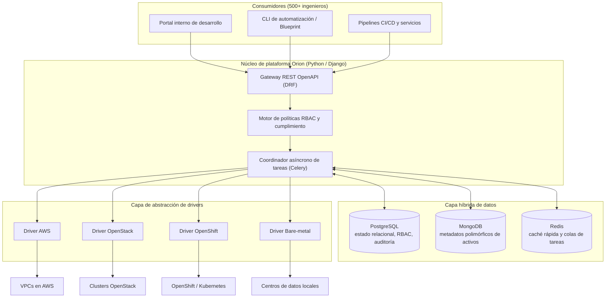

# Orion: Plataforma IaaS Corporativa para Aprovisionamiento y Auditoría

| Dimensión | Detalles |
| :--- | :--- |
| **Rol** | Arquitecto Único y Responsable de Plataforma |
| **Organización** | BBVA Technology · 2017 – presente |
| **Escala** | 30.000+ máquinas · 40.000+ operaciones diarias · 500+ ingenieros |
| **Stack** | Python, Django, DRF, Celery, PostgreSQL, MongoDB, Redis, AWS, OpenStack, OpenShift |

!!! abstract "Resumen ejecutivo (TL;DR)"

    Orion transforma cuatro mundos heterogéneos de infraestructura en **una única API en autoservicio
    y auditable en Python**. Una capa desacoplada de drivers aísla las particularidades de cada proveedor,
    Celery desacopla operaciones de larga duración del ciclo HTTP, y una capa híbrida de datos preserva
    la trazabilidad estricta en PostgreSQL mientras MongoDB absorbe metadatos variables de máquinas.

## 1. Contexto y desafío de ingeniería

A escala bancaria, distintos equipos aprovisionaban y auditaban infraestructura mediante canalizaciones
dispersas en entornos heterogéneos: **AWS**, nubes privadas (**OpenStack**), plataformas de contenedores
(**OpenShift**) y servidores físicos locales (**bare-metal**).

1. **Silos de entorno:** cada infraestructura requería su propio conjunto de herramientas, conocimientos y tickets manuales.
2. **Cuellos de botella en auditoría:** los reguladores bancarios exigen trazabilidad ininterrumpida del estado de las máquinas, líneas base de seguridad y titularidad en más de 30k nodos.
3. **Fricción para el desarrollador:** el aprovisionamiento demoraba días en lugar de minutos por la ausencia de abstracciones en autoservicio.

## 2. Arquitectura de alto nivel

Orion fue concebido para hacer que la infraestructura subyacente sea prácticamente **invisible** para más de
500 ingenieros, asegurando al mismo tiempo una gobernanza 100% auditable.



## 3. Decisiones clave de arquitectura

### A. Capa híbrida de datos (PostgreSQL + MongoDB + Redis)

Más de 30.000 máquinas con configuraciones divergentes (redes, etiquetas, arreglos de discos, campos específicos de hipervisores) hacían inviable un único esquema relacional rígido.

- **PostgreSQL** custodia lo transaccional e inmutable: registros de auditoría, permisos y cambios de estado.
- **MongoDB** ingiere e indexa metadatos polimórficos, permitiendo consultas ultrarrápidas sobre decenas de miles de nodos dispares.
- **Redis** acelera las consultas de permisos y datos frecuentes para mantener tiempos de respuesta de API sub-100ms y da soporte a las colas Celery.

### B. Patrón universal de drivers

Todas las particularidades de proveedor —autenticación, llamadas API, sondeo de estado— se aíslan tras un contrato base de driver en Python. El desarrollador envía la **misma especificación JSON** sin importar el destino; la plataforma resuelve el driver correcto en tiempo de ejecución sin modificar la lógica de negocio. Añadir un nuevo entorno consiste en crear un nuevo driver, no en refactorizar la plataforma.

### C. Procesamiento asíncrono por defecto

El aprovisionamiento de infraestructura puede tardar minutos; las peticiones HTTP deben responder en milisegundos. Las operaciones extensas se delegan a grupos de trabajadores Celery optimizados para I/O concurrente, publicando eventos de progreso en tiempo real.

### Análisis de trade-offs

| Decisión | Alternativa evaluada | Justificación técnica |
| :--- | :--- | :--- |
| Híbrido PostgreSQL + MongoDB | Base de datos relacional única con campos JSON | La auditoría exige integridad referencial estricta; los metadatos de activos son esquemas dinámicos con consultas analíticas complejas |
| Abstracción por drivers en Python | Un pipeline independiente por entorno | Unifica la API y la pista de auditoría; nuevos proveedores son aditivos y modulares |
| Trabajadores asíncronos en Celery | Peticiones HTTP síncronas bloqueantes | Desacopla la latencia de usuario de la del proveedor cloud; permite reintentos automáticos y contrapresión |

## 4. Aspectos destacados de la implementación en Python

Versión ilustrativa y simplificada del contrato de driver y registro automático:

```python title="drivers.py (ilustrativo)"
from __future__ import annotations

from abc import ABC, abstractmethod
from dataclasses import dataclass
from typing import ClassVar


@dataclass(frozen=True, slots=True)
class MachineSpec:
    name: str
    flavor: str
    image: str
    environment: str  # "aws" | "openstack" | "openshift" | "baremetal"


class InfrastructureDriver(ABC):
    """Contrato base que cada driver de infraestructura debe implementar."""

    registry: ClassVar[dict[str, type[InfrastructureDriver]]] = {}
    environment: ClassVar[str]

    def __init_subclass__(cls, **kwargs) -> None:
        super().__init_subclass__(**kwargs)
        InfrastructureDriver.registry[cls.environment] = cls  # (1)!

    @abstractmethod
    def provision(self, spec: MachineSpec) -> str: ...

    @abstractmethod
    def status(self, resource_id: str) -> str: ...

    @abstractmethod
    def decommission(self, resource_id: str) -> None: ...


def driver_for(spec: MachineSpec) -> InfrastructureDriver:
    try:
        return InfrastructureDriver.registry[spec.environment]()
    except KeyError:
        raise ValueError(f"No hay driver registrado para {spec.environment!r}") from None
```

1. Los drivers se auto-registran al importarse, por lo que añadir un nuevo proveedor es crear un archivo nuevo sin tocar el núcleo de la plataforma.

Y en el lado de Celery, desacoplando la ejecución HTTP:

```python title="tasks.py (ilustrativo)"
from celery import shared_task


@shared_task(bind=True, autoretry_for=(ConnectionError,), retry_backoff=True, max_retries=5)
def provision_machine(self, spec_payload: dict, operation_id: str) -> str:
    spec = MachineSpec(**spec_payload)
    resource_id = driver_for(spec).provision(spec)
    record_audit_event(operation_id, action="provision", resource_id=resource_id)
    return resource_id
```

## 5. Impacto y resultados medibles

<div class="kpi-grid">
  <div class="kpi-card"><span class="kpi-value">Días → min</span><span class="kpi-label">Tiempo de aprovisionamiento</span></div>
  <div class="kpi-card"><span class="kpi-value">100%</span><span class="kpi-label">Cumplimiento en auditoría</span></div>
  <div class="kpi-card"><span class="kpi-value">3</span><span class="kpi-label">Países integrados</span></div>
</div>

- :rocket: **Aprovisionamiento sin tickets:** el autoservicio redujo los plazos de entrega de días a minutos automáticos.
- :shield: **100% de cumplimiento en auditoría:** canalizaciones automáticas generan informes de gobernanza directos para los auditores bancarios.
- :earth_africa: **Despliegue internacional:** adoptado con éxito por los centros de ingeniería en España, México y Turquía.

[:octicons-arrow-right-24: Siguiente: Blueprint — el motor declarativo construido sobre Orion](blueprint.md)
