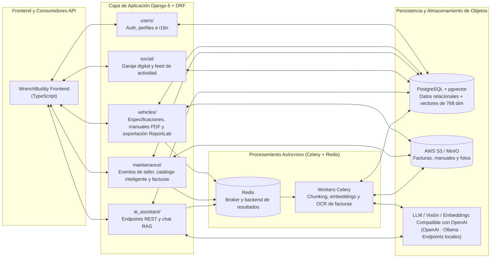

# WrenchBuddy: Plataforma IA de Ciclo de Vida de Vehículos y RAG con `pgvector`

| Dimensión | Detalles |
| :--- | :--- |
| **Rol** | Creador y Mantenedor (Open Source) |
| **Repositorios** | [:fontawesome-brands-github: `oredondo/WrenchBuddy` (Backend)](https://github.com/oredondo/WrenchBuddy) · [:fontawesome-brands-github: `oredondo/WrenchBuddy-frontend` (TypeScript)](https://github.com/oredondo/WrenchBuddy-frontend) (Licencia Apache 2.0) |
| **Dominio** | Arquitectura backend full-stack, colas asíncronas de tareas, OCR por visión y RAG sobre `pgvector` |
| **Stack** | Python 3.12, Django 6.0, Django REST Framework, PostgreSQL (`pgvector`), Celery 5.4, Redis, AWS S3 / MinIO (`boto3`), LangChain, ReportLab, Docker, TypeScript |

!!! abstract "Resumen"

    Mientras que mi trabajo corporativo sobre Orion en BBVA es confidencial, **WrenchBuddy** es una plataforma pública en GitHub estructurada con la misma base arquitectónica: **Django + DRF + Celery + Redis + PostgreSQL**. Combina modelado relacional con **embeddings vectoriales de 768 dimensiones en `pgvector`** sobre manuales técnicos de taller, **extracción asíncrona de facturas por Visión/OCR**, almacenamiento compatible con S3 y un asistente conversacional de mantenimiento con contexto inyectado para motocicletas y automóviles.

---

## 1. Arquitectura del Sistema

---

## 2. Pilares de Ingeniería

### A. Persistencia Relacional y Vectorial Unificada (`PostgreSQL` + `pgvector`)
En lugar de añadir una base de datos vectorial externa independiente que pueda desincronizarse del modelo transaccional, WrenchBuddy utiliza PostgreSQL con la extensión **`pgvector`**:

- Los manuales de taller y fichas técnicas subidos (`PDF` o imágenes) se procesan de forma asíncrona, se dividen en fragmentos semánticos, se transforman en **vectores de 768 dimensiones** y se almacenan vinculados a las claves foráneas del vehículo en PostgreSQL.
- Las consultas combinan filtrado relacional estricto (vehículo exacto y permisos del propietario) con búsqueda de similitud vectorial en un único motor de base de datos.

### B. Extracción Asíncrona de Facturas por Visión/OCR y Catálogos Inteligentes (`Celery` + `Redis`)
Las operaciones pesadas de I/O y llamadas a modelos de IA nunca bloquean los hilos HTTP:

- **Análisis de facturas y recibos de taller:** Cuando el usuario sube una fotografía o PDF de una factura, una tarea en Celery invoca modelos de visión y texto para extraer automáticamente la mano de obra, piezas sustituidas, kilometraje e importes desglosados en registros estructurados de `maintenance`.
- **Síntesis inteligente de planes de mantenimiento:** Trabajos en segundo plano generan planes periódicos adaptados a la marca, modelo, año, cilindrada y tipo de uso del vehículo.

### C. Asistente RAG Contextualizado por Vehículo (`ai_assistant/`)
Cuando el usuario realiza una consulta en lenguaje natural sobre intervalos de revisión, pares de apriete o reparaciones previas, el pipeline en LangChain inyecta:

1. Las especificaciones reales del vehículo y su kilometraje actual.
2. El calendario de mantenimiento calculado y el historial de facturas registradas.
3. Los fragmentos más relevantes del manual técnico recuperados desde `pgvector` — respondiendo en el idioma preferido del usuario (español o inglés).

### D. Almacenamiento Portable S3/MinIO y Exportación PDF con ReportLab
- **Abstracción S3 / MinIO:** Los archivos adjuntos (manuales, facturas, galerías del garaje digital) utilizan `django-storages` y `boto3`, alternando sin cambios de código entre disco local, MinIO auto-alojado y AWS S3 mediante variables de entorno.
- **Informes PDF con ReportLab:** Genera dossieres descargables con el historial completo de mantenimiento y estado del vehículo.

---

## 3. Estructura del Repositorio y Código Fuente

Tanto el backend en Django/Celery como el frontend en TypeScript son software libre bajo licencia Apache 2.0:

- :fontawesome-brands-github: **Backend (`Django` / `Celery` / `pgvector`):** [`github.com/oredondo/WrenchBuddy`](https://github.com/oredondo/WrenchBuddy)
- :fontawesome-brands-github: **Frontend (`TypeScript`):** [`github.com/oredondo/WrenchBuddy-frontend`](https://github.com/oredondo/WrenchBuddy-frontend)

---

[:octicons-arrow-left-24: Anterior: OmniLecture Studio](omni-lecture.md) · [:octicons-arrow-right-24: Volver al Ecosistema de Plataforma](index.md)
