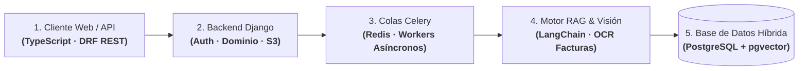

# WrenchBuddy: Plataforma IA de Ciclo de Vida de Vehículos y RAG con `pgvector`

| Dimensión | Detalles |
| :--- | :--- |
| **Rol** | Creador y Mantenedor (Open Source) |
| **Estado** | **Idea en fase temprana / En construcción** (Prototipo activo) |
| **Repositorios** | [:fontawesome-brands-github: `oredondo/WrenchBuddy` (Backend)](https://github.com/oredondo/WrenchBuddy) · [:fontawesome-brands-github: `oredondo/WrenchBuddy-frontend` (TypeScript)](https://github.com/oredondo/WrenchBuddy-frontend) (Licencia Apache 2.0) |
| **Dominio** | Arquitectura backend full-stack, colas asíncronas de tareas, OCR por visión y RAG sobre `pgvector` |
| **Stack** | Python 3.12, Django 6.0, Django REST Framework, PostgreSQL (`pgvector`), Celery 5.4, Redis, AWS S3 / MinIO (`boto3`), LangChain, ReportLab, Docker, TypeScript |

!!! note "Proyecto en fase temprana de desarrollo"

    WrenchBuddy es un proyecto personal e **idea en fase de construcción muy temprana**. Nace como banco de pruebas arquitectónico para aplicar patrones de plataforma empresarial (Django, Celery, PostgreSQL, Redis) a un caso de uso práctico de consumo con IA aplicada (visión artificial y RAG sobre `pgvector`).

!!! abstract "Resumen de arquitectura"

    **WrenchBuddy** es una plataforma open-source en construcción en GitHub que explora la misma base arquitectónica que mi trabajo corporativo: **Django + DRF + Celery + Redis + PostgreSQL**. Integra modelado relacional transaccional con **embeddings de 768 dimensiones en `pgvector`** sobre manuales técnicos de taller, **extracción asíncrona de facturas mediante Visión/OCR**, almacenamiento agnóstico compatible con S3 y un prototipo de asistente conversacional RAG que inyecta el contexto técnico y kilometraje específico de cada vehículo.

---

## 1. Contexto y Desafíos de Ingeniería

La gestión digital de flotas y vehículos particulares suele depender de registros manuales dispersos o herramientas genéricas desconectadas de los manuales de servicio:

1. **Desincronización relacional y vectorial:** Emplear una base de datos vectorial externa independiente genera riesgos de inconsistencia (*split-brain*) frente al modelo transaccional de usuarios, vehículos y mantenimientos.
2. **Latencia en inferencia de visión e IA:** El procesamiento OCR de facturas escaneadas y la generación de embeddings son operaciones pesadas que no pueden bloquear los hilos de petición HTTP de la API REST.
3. **Alucinaciones en asistencia técnica:** Las consultas mecánicas (como pares de apriete o especificaciones de aceite) exigen precisión milimétrica basada exclusivamente en los manuales de taller del fabricante.

---

## 2. Topología Abstracta del Sistema: Flujo de Operación y RAG

La arquitectura desacopla la ingesta síncrona, el despacho en segundo plano, la inferencia de visión y la persistencia híbrida en un pipeline modular:

### Pipeline de Procesamiento Paso a Paso

| Fase | Componente Responsable | Qué se ejecuta exactamente | Garantía de Ingeniería |
| :--- | :--- | :--- | :--- |
| **1. Ingesta API** | Frontend TypeScript / Django REST | Recepción de consultas en lenguaje natural, carga de facturas fotográficas o subida de manuales en PDF. | Validación estricta con serializadores tipados y respuesta HTTP inmediata no bloqueante. |
| **2. Despacho Asíncrono** | Broker Redis & Workers Celery | Encolado de tareas pesadas de I/O, procesamiento de imágenes e inferencia en colas dedicadas con reintentos automáticos. | Aislamiento total del ciclo de petición HTTP del usuario. |
| **3. Visión y OCR** | Tareas Celery de Visión | Análisis multimodal de facturas para extraer piezas sustituidas, mano de obra, kilometraje e importes desglosados. | Conversión estructurada de documentos no normalizados en registros relacionales. |
| **4. Motor RAG** | Pipeline LangChain | Chunking semántico de manuales técnicos, generación de vectores de 768 dimensiones y búsqueda por similitud de coseno. | Respuestas fundamentadas estrictamente en la documentación oficial del vehículo. |
| **5. Persistencia Híbrida** | PostgreSQL con extensión `pgvector` | Almacenamiento unificado de tablas relacionales (ACID) y colecciones vectoriales vinculadas por claves foráneas. | Cero desincronización de datos sin necesidad de bases de datos vectoriales externas. |

---

## 3. Decisiones Clave de Arquitectura

### A. Persistencia Relacional y Vectorial Unificada (`pgvector`)
En lugar de introducir una base de datos vectorial externa (como Pinecone o Weaviate) que añada sobrecarga operativa y problemas de sincronización:
- **`pgvector` sobre PostgreSQL:** Permite combinar filtros relacionales estrictos (pertenencia de vehículo, permisos RBAC de usuario) con búsquedas de similitud vectorial de 768 dimensiones en una sola consulta SQL transaccional.
- **Consultas atómicas:** Si se elimina un vehículo o se actualiza una entrada de mantenimiento, la consistencia referencial garantiza la integridad inmediata de sus embeddings asociados.

### B. Desacoplamiento Asíncrono con Celery y Redis
Toda operación que supere los 200 ms de procesamiento se delega a workers de fondo:
- **OCR de facturas en segundo plano:** La subida de imágenes o PDFs despacha tareas de visión artificial que analizan el documento, estructuran los costes y notifican al usuario cuando los datos están consolidados en su garaje.
- **Generación de catálogos periódicos:** Algoritmos en segundo plano calculan intervalos de mantenimiento personalizados según kilometraje, uso y fecha de última intervención.

### C. Asistente RAG Contextualizado por Vehículo
El motor conversacional no responde de forma genérica:
1. Extrae los metadatos exactos del vehículo (marca, modelo, año, kilometraje actual).
2. Consulta el historial relacional de facturas y servicios previos.
3. Recupera los fragmentos más relevantes del manual de taller indexados en `pgvector` y ensambla el prompt enriquecido bajo guardarraíles de fidelidad técnica.

### D. Almacenamiento Agnóstico S3 y Generación de Dossiers PDF
- **Abstracción S3 / MinIO:** Mediante `django-storages` y `boto3`, la plataforma conmuta sin tocar código entre almacenamiento local para desarrollo, MinIO auto-alojado o AWS S3 en producción.
- **Dossiers técnicos con ReportLab:** Generación programática de informes en PDF con el historial completo de intervenciones, facturas y métricas de kilometraje para traspaso o venta del vehículo.

---

## 4. Trade-Offs de Arquitectura

| Decisión | Alternativa Evaluada | Justificación |
| :--- | :--- | :--- |
| **PostgreSQL + `pgvector`** | Base de datos vectorial dedicada (Pinecone/Milvus) | Elimina la complejidad operativa de sincronizar dos bases de datos y garantiza integridad transaccional ACID en una sola capa. |
| **Workers Celery asíncronos** | Procesamiento síncrono en hilos HTTP | Previene saturación de sockets web y tiempos muertos durante la inferencia OCR de visión. |
| **Almacenamiento S3 / MinIO con `boto3`** | Almacenamiento estático en disco local | Proporciona portabilidad cloud-native inmediata entre entornos locales de desarrollo y producción en la nube. |
| **RAG restringido por modelo de vehículo** | Consultas abiertas a LLMs generalistas | Garantiza que los pares de apriete, tolerancias y fluidos provengan exactamente del manual oficial del fabricante. |

---

## 5. Código Fuente y Repositorios Open Source

Tanto el backend en Django/Celery como el frontal en TypeScript están publicados bajo licencia Apache 2.0:

- :fontawesome-brands-github: **Backend (`Django 6` / `Celery` / `pgvector`):** [`github.com/oredondo/WrenchBuddy`](https://github.com/oredondo/WrenchBuddy)
- :fontawesome-brands-github: **Frontend (`TypeScript` / `Vite`):** [`github.com/oredondo/WrenchBuddy-frontend`](https://github.com/oredondo/WrenchBuddy-frontend)

---

[:octicons-arrow-left-24: Anterior: OmniLecture Studio](omni-lecture.md) · [:octicons-arrow-right-24: Volver al Ecosistema de Plataforma](index.md)
